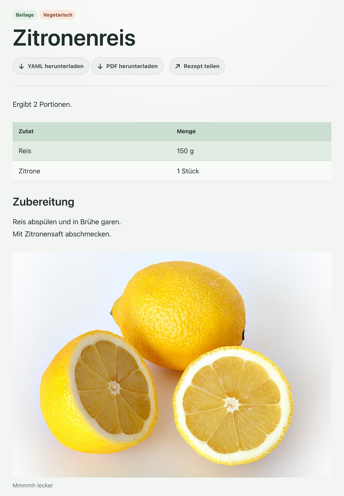

<p align="center">
	
</p>

<h1 align="center">reciperepo</h1>

<p align="center">
	Dein ruhiges, persönliches Rezeptarchiv für Küche, Familie und Alltag.
</p>

<p align="center">
	Rezepte übersichtlich sammeln, lesen und als PDF mitnehmen.
</p>

## Deine Rezeptsammlung

reciperepo ist eine kleine, private Rezeptbibliothek für Menschen, die ihre Rezepte selbst besitzen und unkompliziert pflegen möchten. Statt verstreuter Notizen, Screenshots und Links liegen alle Lieblingsrezepte an einem Ort.

Die Sammlung ist öffentlich lesbar und funktioniert auf dem Computer, Tablet und Smartphone. Die Verwaltung bleibt geschützt und ist für die Person gedacht, die Rezepte hinzufügt und aktualisiert.

## Was dich erwartet

- **Übersichtliche Sammlung:** Alle Rezepte auf einen Blick, sortierbar nach Name, Änderungsdatum oder Kategorie.
- **Schnelles Wiederfinden:** Kategorien und eine Suche helfen auch bei einer wachsenden Sammlung.
- **Angenehmes Lesen:** Titel, Kurzbeschreibung, Zutaten, Zubereitung, Bilder und weiterführende Links werden klar dargestellt.
- **Für die Küche:** Jede Rezeptseite kann als PDF heruntergeladen werden.
- **Eigene oder fremde Bilder:** Rezeptbilder lassen sich direkt in der Verwaltung hochladen oder extern einbinden.
- **Einfach mitzunehmen:** Rezepte liegen als gut lesbare YAML-Dateien vor und können gesichert oder zwischen Installationen übertragen werden.
- **Respekt vor deinen Daten:** Die Sammlung kommt ohne Benutzerkonto, Werbung und externe Plattform aus.

## Ein Rezept kann so aussehen

<p align="center">
	
</p>

Ein Rezept besteht aus einem Titel und frei kombinierbaren Abschnitten. Dadurch bleibt es kurz und einfach oder wird so ausführlich, wie du es brauchst.

```yaml
version: 1
title: Zitronenreis
summary: Zitroniger Reis als frische Beilage.
image:
  url: "https://upload.wikimedia.org/wikipedia/commons/e/e4/Lemon.jpg"
  alt: "Eine Zitrone"
aliases: [Zitronen-Reis, Lemon Rice]
tags: [Beilage, Vegetarisch]
blocks:
  - type: text
    text: Ergibt 2 Portionen.
  - type: table
    headers: [Zutat, Menge]
    rows:
    - [Reis, "150 g"]
    - [Zitrone, "1 Stück"]
  - type: heading
    text: Zubereitung
  - type: text
    text: |
     Reis abspülen und in Brühe garen.
     Mit Zitronensaft abschmecken.
  - type: image
    url: "https://upload.wikimedia.org/wikipedia/commons/e/e4/Lemon.jpg"
    alt: "Eine Zitrone"
    Caption: "Mmmmh lecker"
  - type: link
    url: "https://de.wikipedia.org/wiki/Lemon_Tree_(Fools-Garden-Lied)"
    label: "Ein Song über einen Zitronenbaum"
```

Neben Text, Überschriften und Zutatenlisten sind auch Bilder, Audio, Videos und Links möglich. Ein vollständiges Beispiel findest du in [examples/zitronenreis.yaml](examples/zitronenreis.yaml).

Wenn du vorhandene Notizen in Rezepte umwandeln möchtest, hilft die [KI-Anleitung für YAML-Rezepte](docs/llm-yaml-authoring.md).

## Transparenzhinweise

Diese Software wurde mithilfe künstlicher Intelligenz entwickelt.
